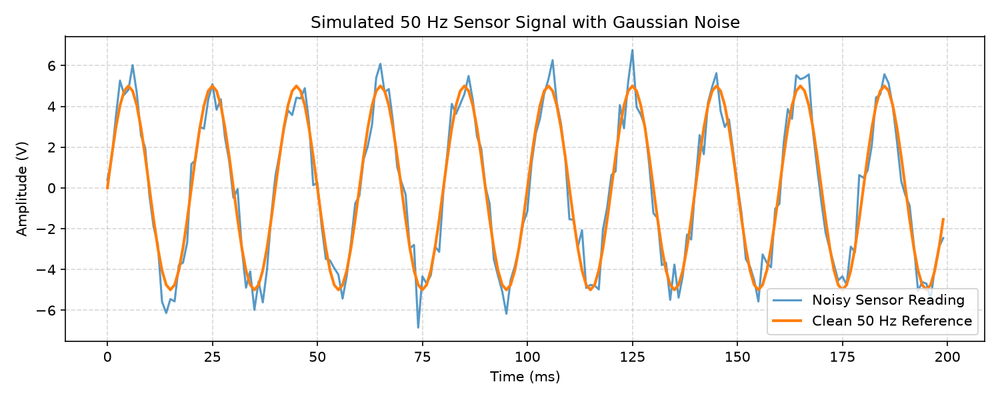
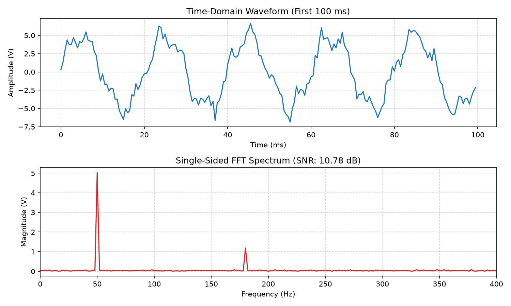

# ECE Simulation & Signal Diagnostic Toolkit

Automated Python workflows for analyzing time-domain waveforms, computing FFT spectra, and calculating Signal-to-Noise Ratio (SNR) from hardware and simulation logs.

## Outputs
- **Time-Domain Signal Modeling:** `generate_signal.py`
  
- **Frequency-Domain FFT & SNR Diagnostics:** `analyze_spectrum.py`
  